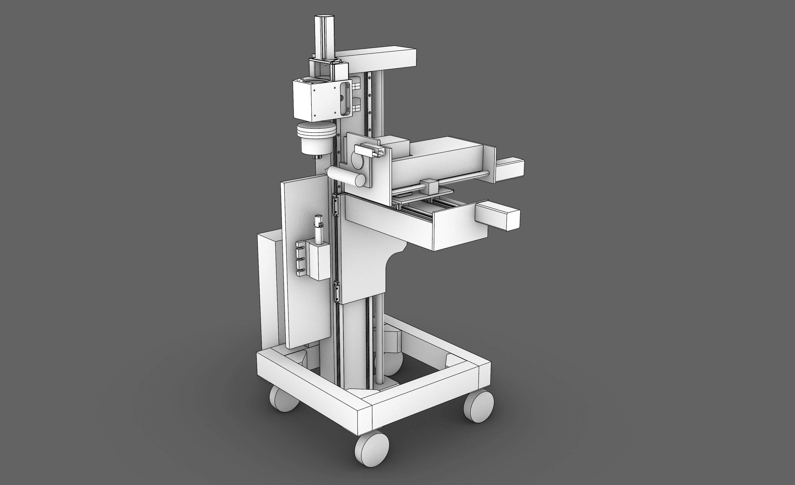

# Hanzito
*A five axis CNC lathe and mill with a focus on reuse of discarded components*

*A rough CAD sketch of the planned machine architecture as of October 2026*

Current status:
- The headstock has been tested on a ShopBot PRS Alpha 96-48
- A dumpster dived industrial linear actuator has been renovated and will become the backbone of Hanzito
