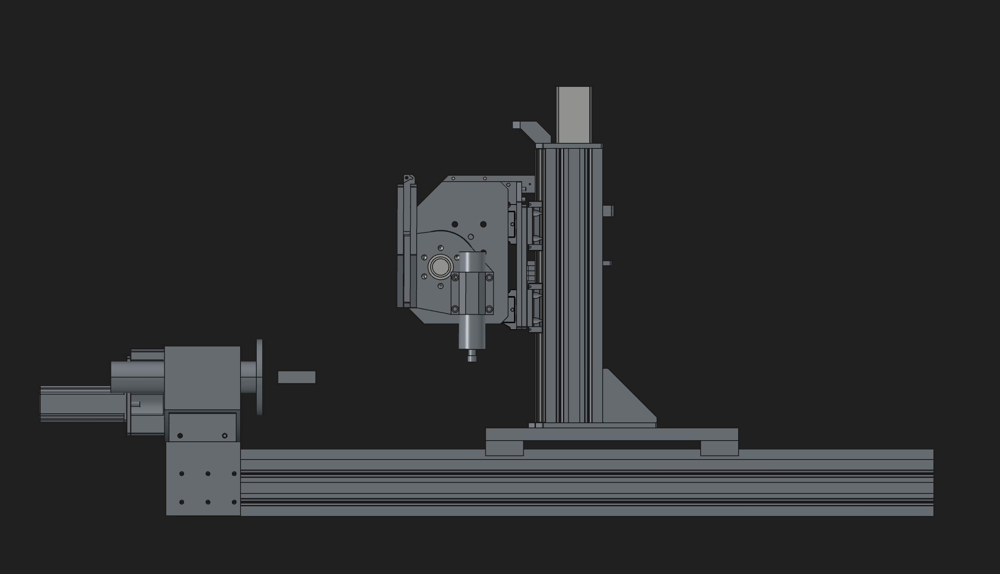
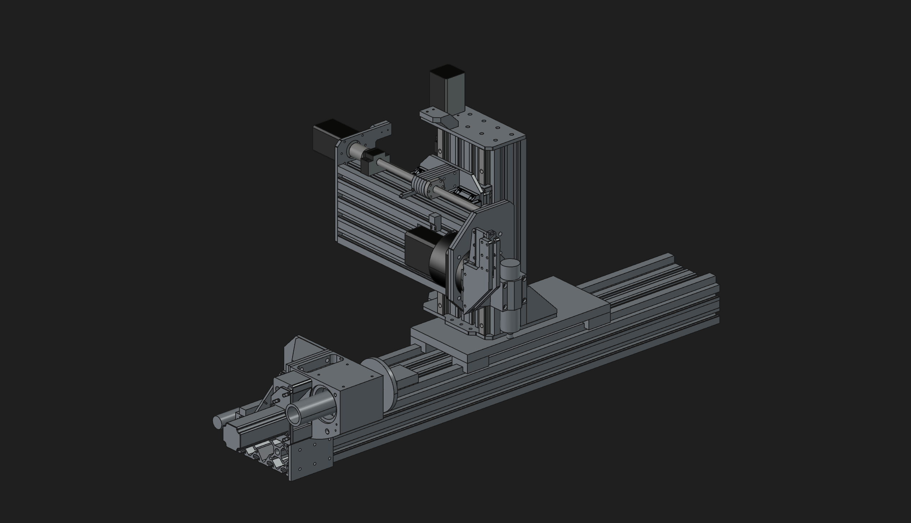
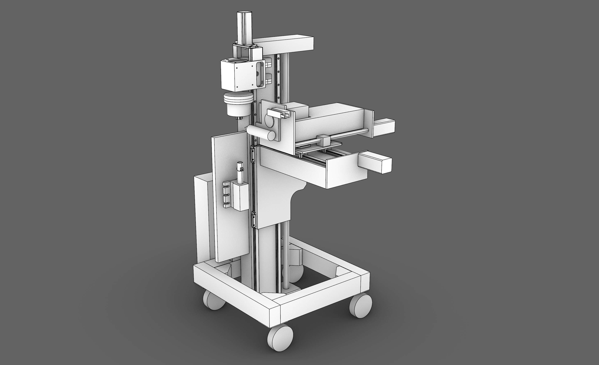

# Hanzito
*A five axis CNC lathe and mill with a focus on reuse of discarded components. By Jens Dyvik*

**Current status:**
- The headstock has been tested on a ShopBot PRS Alpha 96-48
- A dumpster dived industrial linear actuator has been renovated and will become the backbone of Hanzito
- Parts for making to more linear axis and one rotary has been ordered. See BOM

# Dev log

### November 2026

*A more detailed CAD plan for the machine*

*Note the embedded servo motor with a harmonic drive gearbox holding the tools. It makes the B-axis of the machine while the lathe headstock makes the A-axis*

### October 2026

*A rough CAD sketch of the planned machine architecture as of October 2026*
